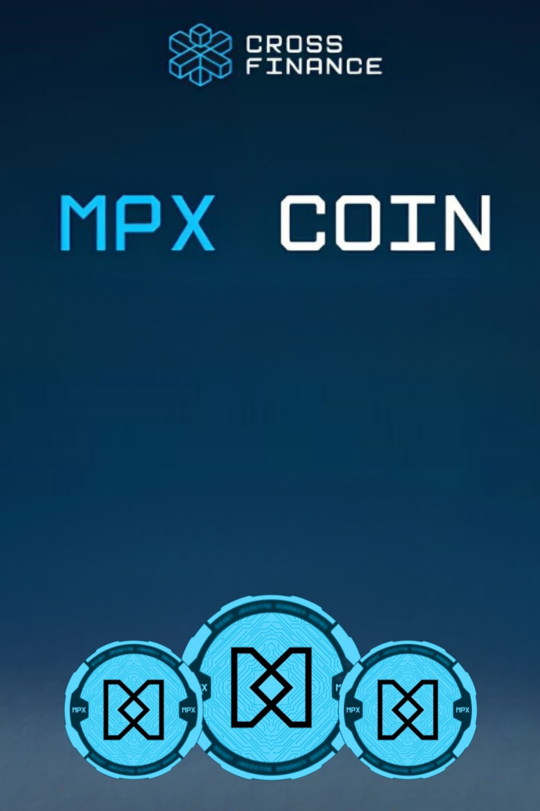
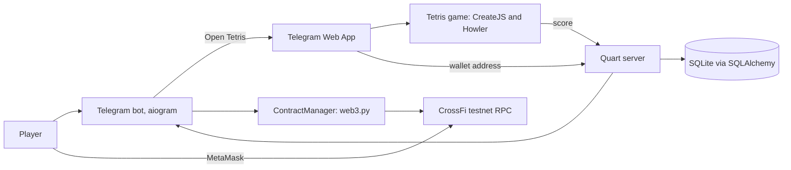
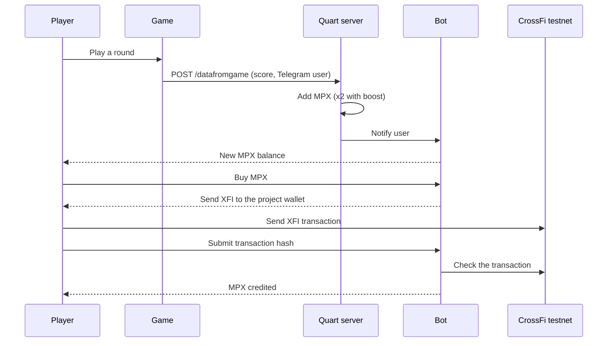

# Tetris for CrossFi

Play Tetris inside Telegram, earn **MPX** coins for your score, and swap them with **XFI** on the CrossFi testnet.

Built for the CrossFi hackathon.

<p align="center">
  
</p>

> **Status: testnet prototype.** MPX is a testnet points token. All balances and swaps run on the CrossFi testnet and have no real value.

## How it works

1. Open the Telegram bot and press **Open Tetris!** The game opens as a Telegram Web App.
2. Play. When the game ends, the score goes to the server.
3. The server credits MPX to your balance and the bot sends you a message with your new balance.
4. Connect MetaMask, then buy MPX with XFI or swap MPX back to XFI on the CrossFi testnet.

## Features

- **Tetris in the browser and in Telegram:** classic game with sound, pause, help, fullscreen, mobile layout and landscape detection.
- **MPX rewards:** your score is added to your MPX balance.
- **Boost:** pay 15 XFI to earn double MPX for 24 hours.
- **Referral program:** invite a friend and get 30 MPX when they join through your link.
- **Wallet connection:** MetaMask, with a TON Connect endpoint prepared.
- **Buy MPX:** send XFI to the project wallet, submit the transaction hash in the bot, and the server checks the transaction on-chain before crediting MPX.
- **Swap MPX to XFI:** withdraw MPX as XFI to your MetaMask address, with a confirmation step.
- **Profile:** balance, wallet, referral link and boost status in one message.
- **Token creation:** the bot links to the CrossFi Coin Minter for creating your own token.

## Architecture





## Tech stack

| Layer | Tools |
| --- | --- |
| Game | JavaScript, CreateJS, Howler.js, jQuery |
| Web server | Python, Quart, Hypercorn, Caddy (reverse proxy and HTTPS) |
| Telegram bot | aiogram 3, APScheduler |
| Database | SQLite, SQLAlchemy 2 (async) |
| Blockchain | web3.py, CrossFi testnet, MetaMask |

## Project structure

```
bot.py                 Telegram bot: start, profile, referrals, buy and swap MPX
server_quart.py        Web server: serves the game, receives scores and wallet data
contractXFI/           ContractManager: sends and checks XFI transactions
database/              SQLAlchemy models and queries (users, transactions)
templates/             Telegram Web App pages: tetris, game, wallet
js/                    Game code and wallet connection
sprites/ sounds/ css/  Game assets
Caddyfile              Reverse proxy configuration
```

## Getting started

Requirements: Python 3.11 or newer, a Telegram bot token, and a wallet with testnet XFI.

```shell
git clone https://github.com/Godblessmylife/TetrisGameCrossFiWeb3
cd TetrisGameCrossFiWeb3
pip install -r requirements.txt
```

Set your values in a local configuration that is not committed:

- the Telegram bot token (`API_TOKEN` in `bot.py`);
- the wallet private key for the payout account (`PRIVATE_KEY_FROM_ENV` in `contractXFI/ContractManager.py`);
- the public HTTPS URL of the game (needed by Telegram Web Apps).

Run the web server and the bot:

```shell
hypercorn server_quart:app --bind 127.0.0.1:8000
python bot.py
```

Put Caddy in front of the server with the included `Caddyfile` for HTTPS.

Use a dedicated testnet wallet. Never commit a private key or a bot token.

## Roadmap

- Validate scores on the server instead of trusting the value sent by the game.
- Read the bot token and wallet key from environment variables.
- Use one exchange rate for buying and swapping MPX.
- Add the MPX conversion to mainnet after the emission ends.
- Leaderboard and daily rewards.

## Credits

Made for the CrossFi hackathon. Authors on Telegram: @web3elchapo, @PBAsync.
